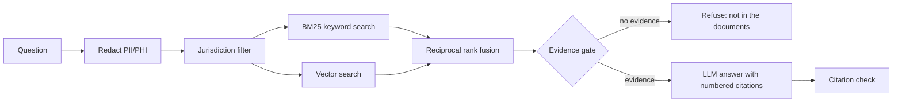

# coverage-rag

Ask a health coverage question and get an answer that cites the exact policy
clause it came from, over two real document sets:

- **US:** all 345 Medicare National Coverage Determinations (CMS)
- **India:** the IRDAI Master Circular on Health Insurance (2024) and the
  Arogya Sanjeevani standard policy wording

Built for Azure (Azure OpenAI + Azure AI Search) and runnable locally without
any cloud account.

```
POST /ask
{"question": "Patient name: Ravi Sharma, phone 9876543210. What is the room rent limit in Arogya Sanjeevani?",
 "jurisdiction": "IN"}

redactions: {"PHONE": 1, "NAME": 1}
sources:
  1 arogya-sanjeevani-p6#53   3.47 Room Rent
  2 arogya-sanjeevani-p7#61   4.1.1 Other expenses
  3 arogya-sanjeevani-p22#119 1 Room Rent
  4 arogya-sanjeevani-p21#118 1 Room Rent
  5 arogya-sanjeevani-p7#60   4.1 Hospitalization   <- "up to 2% of the sum insured subject to maximum of Rs.5000/-, per day"
answer: generated from these numbered sources, each claim cited as [n]
```

(Retrieval output above is from local mode with no API keys. With a model
configured, the answer is written only from the listed sources.)

## How it works



1. **Redaction first.** Names after a label, phone numbers, emails, dates of
   birth, Aadhaar, PAN, US SSN, Medicare Beneficiary IDs and record numbers are
   masked before the question reaches search, the model or a log.
2. **Filter, then rank.** The jurisdiction is a filter applied before ranking,
   not something similarity is hoped to sort out.
3. **Hybrid retrieval.** BM25 catches exact strings (NCD numbers, "Rs.5000",
   "48 months"); vectors catch paraphrase. The two lists are merged with
   reciprocal rank fusion (k=60), which uses ranks only, so the scores never
   need to be comparable. In Azure mode the same query runs inside Azure AI
   Search (keyword + HNSW vector, optional semantic reranker).
4. **Evidence gate.** If the best passage shares too little with the question,
   the assistant says it can't answer from these documents and never calls the
   model. One shared word ("capital") is not evidence.
5. **Grounded answer.** LangChain prompt, temperature 0, sources marked as
   data rather than instructions, every claim cited as `[n]`, limits quoted as
   written. The answer is then checked: a citation to a source that wasn't
   shown is reported.

**Chunking follows the documents.** NCDs split on their own sections and
lettered parts ("B. Nationally Covered Indications"); the PDFs split on dotted
clause numbers ("3.31. Medically Necessary Treatment"), and the non-payable
item lists stay together instead of becoming one heading per line. Every chunk
carries its heading path.

## Evals

`python -m evals.run_evals` runs 25 labelled cases from `evals/golden.jsonl`:
19 answerable questions with the passage that answers them, 5 out-of-scope
questions, 1 question full of personal identifiers.

Keyword-only local mode (no API keys, what CI runs on every push):

| Metric | Result |
|---|---|
| Recall@5 | 0.95 (19/20) |
| MRR | 0.72 |
| Out-of-scope refused | 5/5 |
| Identifiers redacted | 1/1 |

The one miss is instructive: "How often does Medicare cover a screening fecal
occult blood test?" The answer says "one screening FOBT per annum". No word in
"how often" matches "per annum", which is the case vector search exists for.
With `LLM_PROVIDER` set, the same script also grades the generated answers
(required facts present, citations valid, no wrongful refusal) and CI can gate
on it via the `answer-evals` job.

## Run it

```bash
uv venv && uv pip install -e ".[dev]"
python -m coverage_rag.ingest          # data/raw -> data/chunks.jsonl (already committed)
pytest -q
python -m evals.run_evals
uvicorn coverage_rag.api:app --reload  # http://localhost:8000/docs
```

Retrieval works with no keys (`LLM_PROVIDER=none`). For answers, copy
`.env.example` to `.env` and set either:

- **Azure:** `LLM_PROVIDER=azure` plus the `AZURE_OPENAI_*` values. For Azure AI
  Search, also set `SEARCH_BACKEND=azure` and `AZURE_SEARCH_*`, then build the
  index with `python -m coverage_rag.azure_search`.
- **Any OpenAI-compatible endpoint:** `LLM_PROVIDER=openai` and `OPENAI_*`.

Docker: `docker build -t coverage-rag . && docker run -p 8000:8000 --env-file .env coverage-rag`

## Layout

```
coverage_rag/
  ingest.py        structure-aware chunking for NCD JSON and IRDAI PDFs
  search.py        local hybrid retrieval (BM25 + vectors + RRF), evidence score
  azure_search.py  Azure AI Search index + hybrid query
  guardrails.py    PII/PHI redaction, evidence gate, citation check
  llm.py           Azure OpenAI / OpenAI through LangChain
  rag.py           the pipeline
  api.py           FastAPI
evals/             golden set + runner (CI-gated)
scripts/fetch_ncd.py  pulls NCDs from the public CMS Coverage API
```

## Data

- Medicare National Coverage Determinations, from the
  [CMS Coverage API](https://api.coverage.cms.gov/). US government work. Only the
  narrative fields are kept; billing-code tables, which can carry AMA-licensed
  CPT content, are not ingested.
- [IRDAI Master Circular on Health Insurance Business, 29.05.2024](https://irdai.gov.in/document-detail?documentId=4942918)
  (IRDAI/HLT/CIR/PRO/84/5/2024).
- Arogya Sanjeevani Policy wording, The New India Assurance Co. Ltd., UIN
  NIAHLIP20165V011920, as filed with and hosted by IRDAI. Arogya Sanjeevani is
  an IRDAI-mandated standard product with common wording across insurers.

Answers summarise policy text. They are not medical, legal or insurance advice,
and a real claim decision depends on the individual policy and case.

## Limits

- Redaction is pattern-based. It catches labelled names and structured
  identifiers; a bare name in free text needs an NER model (Azure AI Language
  PII detection is the natural swap on Azure).
- The evidence gate uses word overlap, which is cheap and explainable but
  blunt. A reranker score would be a better gate once one is in the loop.
- The Azure AI Search path is written against the official SDK but is not
  exercised in CI, which runs without Azure credentials.

## License

MIT for the code. Source documents remain under their publishers' terms.
